# MEME Launcher

一个从零写的 Minecraft: Java 版启动器 —— 自绘 3D 主界面、四种加载器一键安装、内置联机开服、内容站下载、多账号管理。

**不需要装 .NET、不需要 Java 环境预配置**：下载单个 exe，双击就用。

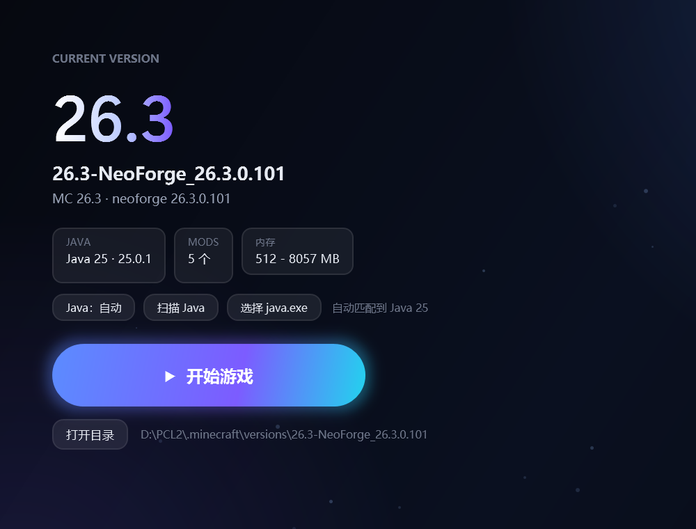

[](https://github.com/OStonefishO/STMEMELauncher/stargazers)
[](https://github.com/OStonefishO/STMEMELauncher/releases)
[](https://github.com/OStonefishO/STMEMELauncher/releases)
[](LICENSE)
[](https://ostonefisho.github.io/STMEMELauncher/)
[]()

> 如果这个启动器帮到你，点个 **Star ⭐** 就是最好的支持——它也会帮这个项目更快拿到免费代码签名，让更多人能直接双击打开。

---
## 界面：六套设计语言，一键切换

同一个启动器，六种完全不同的长相，标题栏右侧 **◐** 按钮循环切换，设置里下拉框直接选，选择会记住。

| 布局 | 导航位置 | 首页形态 | 悬停手感 | 音效 |
|---|---|---|---|---|
| **新版（动感）** | 顶部浮动胶囊 | 卡片仪表盘（版本大卡 + 3D 岛 + 内容 + 快捷） | 发光 + 放大 1.2% | 合成点击音（40ms 正弦） |
| **终端** | 顶部浮动胶囊 | 卡片仪表盘，等宽字、1px 荧光细边 | 荧光绿描边泛光 | 方波机械 beep（32ms） |
| **纸质便签** | **左侧竖栏** | **单列活页清单**（01/02/03/04 编号行） | 卡片轻微倾斜 0.7° | 低频木头「笃」声（50ms） |
| **像素 8bit** | **底部状态条** | **方块网格**（左大卡 + 右上内容 + 右下菜单） | 向上位移 3px 的阶跃 | 双音方波琶音（90ms） |
| **毛玻璃极光** | 顶部浮动胶囊 | 卡片仪表盘，低对比大圆角、柔和光晕 | 极慢放大 + 大范围柔光 | 柔和正弦 + 短延迟（160ms） |
| **经典** | 左侧图标栏 | 原始大图首页（3D 岛占右半屏） | 无动效 | 无 |

### 预览

<table>
  <tr><td>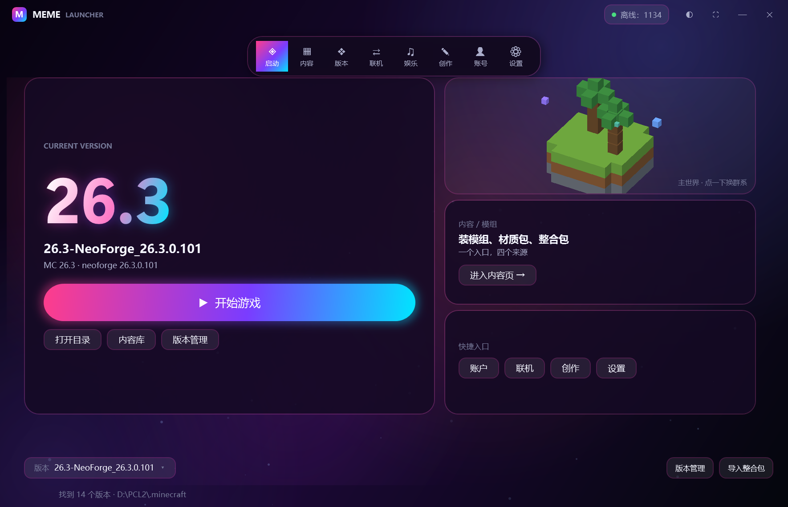<br><sub>新版（动感）</sub></td><td>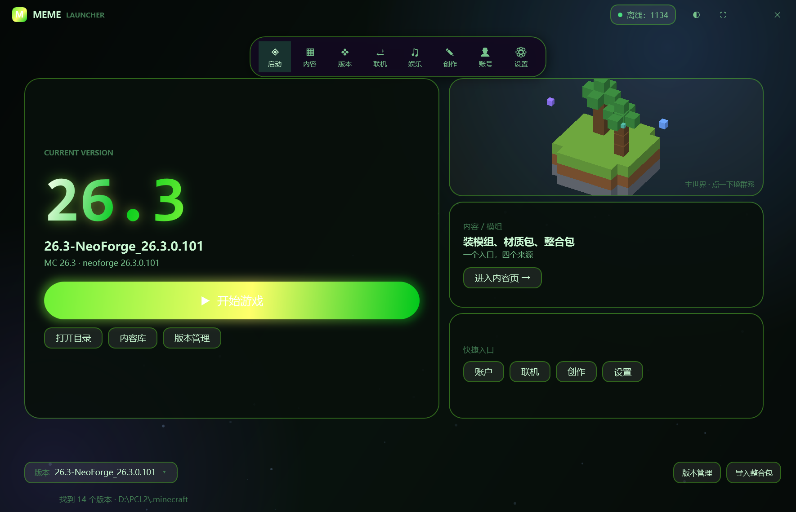<br><sub>终端（荧光绿）</sub></td><td>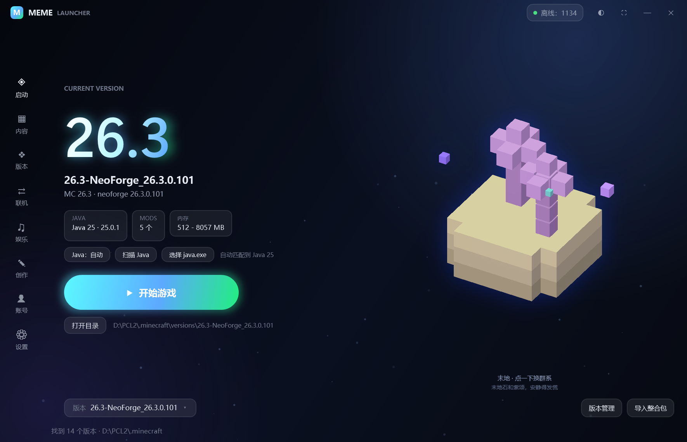<br><sub>经典（左栏）</sub></td></tr>
  <tr><td>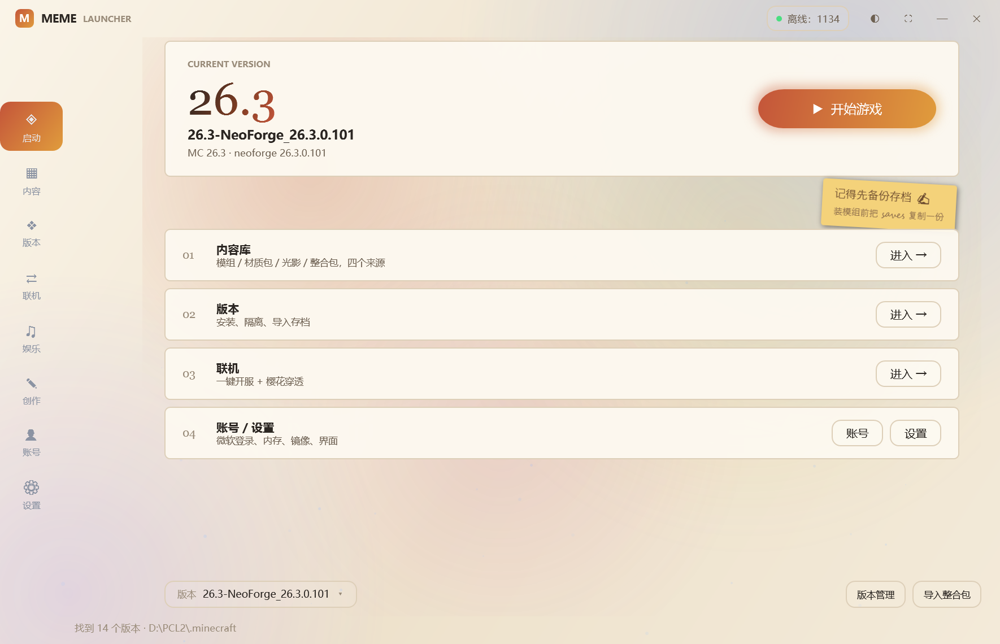<br><sub>纸质便签（浅色）</sub></td><td>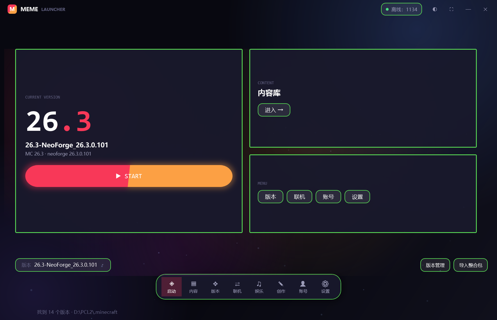<br><sub>像素 8bit（NES）</sub></td><td>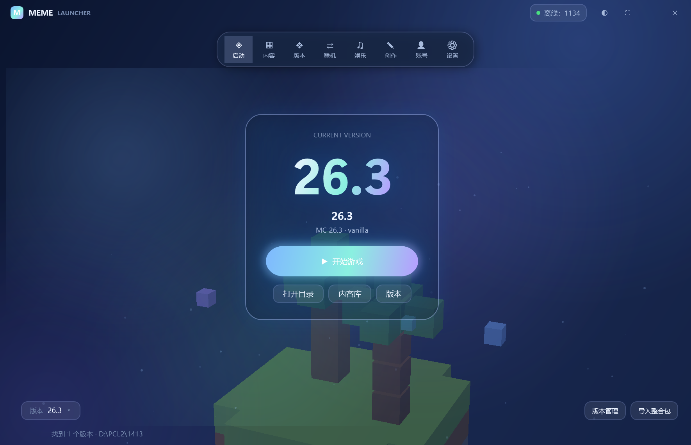<br><sub>毛玻璃极光</sub></td></tr>
</table>

另外两页：

<table>
  <tr><td>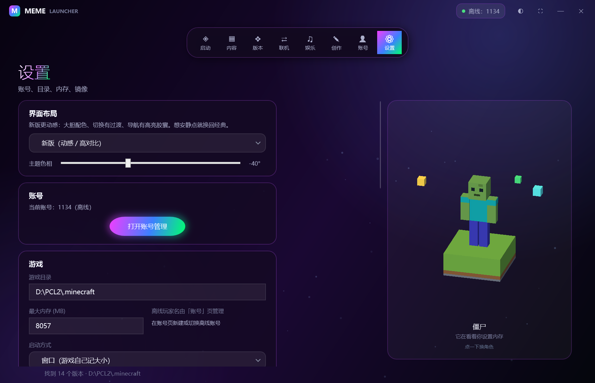<br><sub>设置（含布局与色相）</sub></td><td>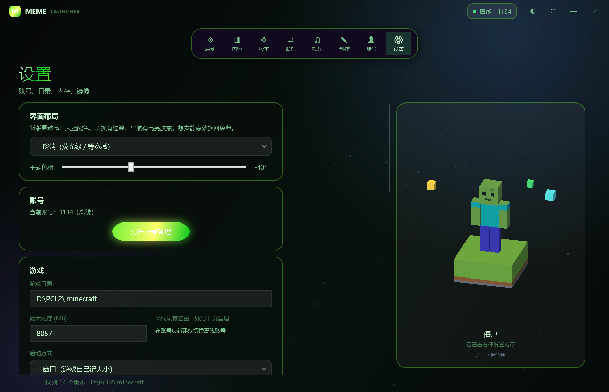<br><sub>终端设置页</sub></td><td>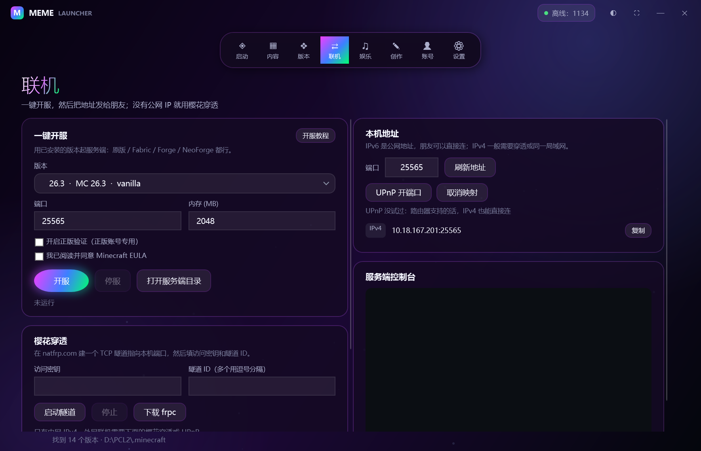<br><sub>联机页</sub></td></tr>
</table>

## 亮点

- **可点的 3D 主界面**：方块岛点一下换群系（主世界 / 下界 / 末地），配色、打光、文案全变
- **中文翻译**：内容页打开后，模组简介自动翻中文，分类标签（战斗 / 冒险 / 科技 / 优化 / 前置库…）直接显示中文，可一键关闭
- **缺 Java 就装**：没有匹配版本的 Java 时弹窗问你要不要自动下载安装 Temurin JRE
- **存档导入**：版本页「导入存档」，文件夹或 zip 直接放进这个版本真正读的 `saves`
- **启动方式**：窗口 / 窗口化全屏 / 独占全屏
- **崩溃诊断**：启动即退出或崩溃都给「人话」结论，可导出报告；每次启动的完整日志落在 `%APPDATA%\MEMELauncher\logs`
- **站外搜**：MC 百科 / Planet Minecraft / Minecraft Maps / Nexus Mods / ShadersMods；模组详情可一键跳 MC 百科
- **启动前自检 + 自动补齐**：每次点开始游戏先检查配置 / jar / 依赖库 / natives / assets，Forge & NeoForge 还会检查 `-p` 模块路径，缺什么当场补（含自动跑安装器），补不上才拦下并说明缺哪个文件
- **下载来源可切换**：版本/核心（自动 / 官方 / BMCLAPI 镜像）与模组内容（自动 / 官方 / MCIM 镜像）分开设置，镜像抽风就切官方，嫌慢就切镜像
- **内容「保存」按钮**：每个版本都能只下载到指定文件夹，方便手动导入到别的启动器
- **Fabric 一键补基础模组**：版本页「设置 → 补装 Fabric API / Mod Menu」，自动按 MC 版本找适配版
- **界面音效**：按钮、启动成功/失败提示音，音量可调、可整体关闭（代码合成，不带音频文件）
- **「其他」页**：下载来源、导入导出设置、打开配置/日志/游戏目录、清空缓存、免责声明、高级选项（JVM/游戏参数、启动前命令、内存调优 G1GC/ZGC、Java Launch Wrapper、LWJGL Unsafe Agent）

<table>
  <tr><td><br><sub>主世界</sub></td><td>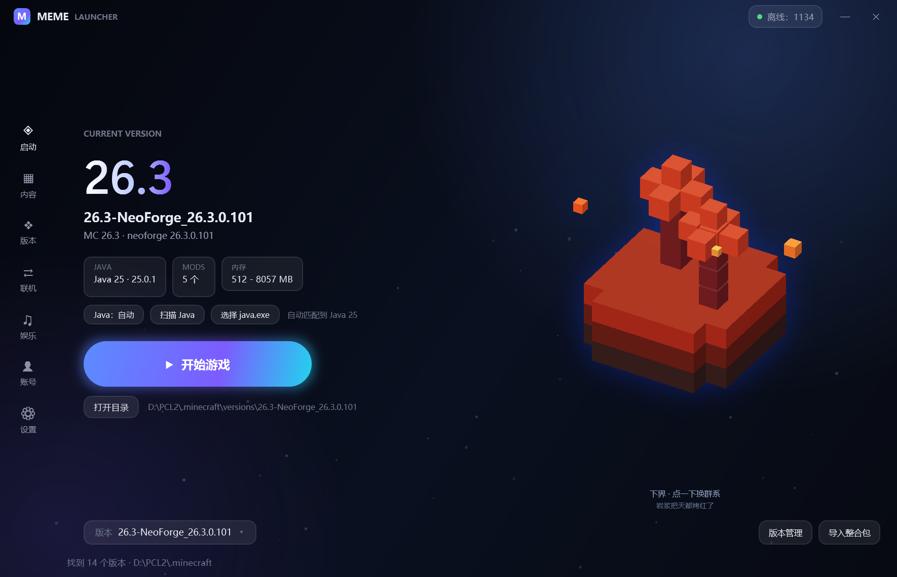<br><sub>下界</sub></td><td>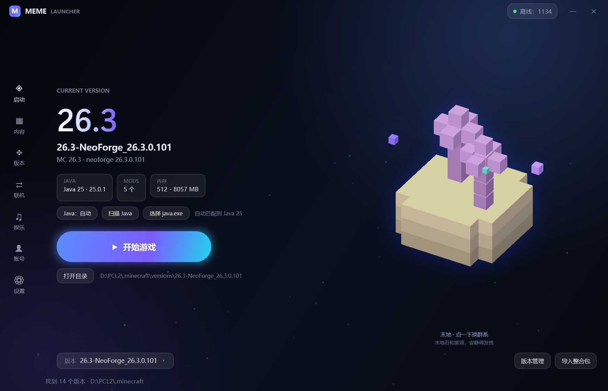<br><sub>末地</sub></td></tr>
</table>

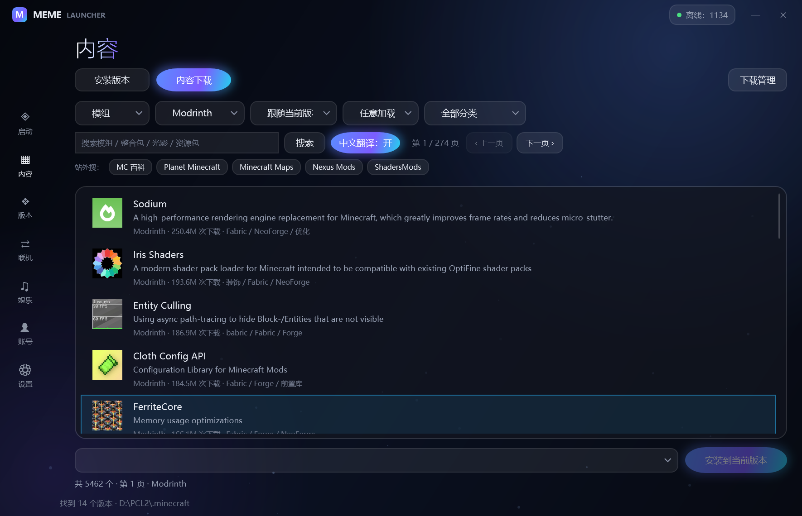
## 安全性

- 漏洞请**不要**开公开 Issue，走 GitHub 私密报告：<https://github.com/OStonefishO/STMEMELauncher/security/advisories/new>
- 处理流程、支持版本、哪些算安全问题：见 [SECURITY.md](SECURITY.md)
- 发布产物**目前没有代码签名证书**，Windows 11 智能应用控制会拦，这是已知现象，处理办法见 [docs/SMART-APP-CONTROL.md](docs/SMART-APP-CONTROL.md)
- 我们已做的：HTTPS 下载 + Mojang 资源校验、令牌不写日志、参数数组启动、解压限制在目标目录内、自更新只取本仓库 Release 资产

## 下载

> 想先看效果？打开官网宣传站：https://ostonefisho.github.io/STMEMELauncher/


| 通道 | 地址 | 说明 |
|---|---|---|
| **Gitee 国内镜像** | [stonefish8/STMEMELauncher](https://gitee.com/stonefish8/STMEMELauncher/releases) | ⭐ 国内首选，实测 3.28 MB/s |
| **GitHub Releases** | [最新版本](https://github.com/OStonefishO/STMEMELauncher/releases/latest) | 原版，海外/有代理时最快 |
| **gh-proxy 加速** | `https://gh-proxy.com/` + Release 资产地址 | 国内可用，已实测 65.9MB 完整下载 |
| **ghfast 加速** | `https://ghfast.top/` + Release 资产地址 | 备用 |
| **ghproxy.net 加速** | `https://ghproxy.net/` + Release 资产地址 | 备用 |

加速链接示例（把 `<资产文件名>` 换成 Release 里的 exe 名）：

```
https://gh-proxy.com/https://github.com/OStonefishO/STMEMELauncher/releases/download/v0.5.7/MEME-Launcher-v0.5.7.exe
```

> 启动器内置的「一键更新」也会自动依次尝试 直连 → gh-proxy → ghfast，国内网络下不用手动找镜像。

### ⚠️ 双击没反应 / 提示「智能应用控制已阻止」

Windows 11 的 **Smart App Control** 会拦掉所有没有数字签名的 exe，弹窗里还没有「仍要运行」。
这不是病毒，是没买代码签名证书。处理办法（关闭 SAC / 换机器 / 等微软审核）写在
[docs/SMART-APP-CONTROL.md](docs/SMART-APP-CONTROL.md)，每次发版也会附带 `使用说明-<版本>.txt` 和 `SHA256` 校验值。

签名方案与自动发版流程见 [docs/SIGNING.md](docs/SIGNING.md)（SignPath 对开源项目免费）。

> 本项目使用 **SignPath Foundation** 提供的免费代码签名服务为发布包签名。
> This project uses the free code signing provided by SignPath Foundation.

---

## 现在能做什么

### 启动与版本

| 能力 | 说明 |
|---|---|
| 扫描 `.minecraft/versions` | 自动识别 Forge / NeoForge / Fabric / Quilt / OptiFine / 原版 |
| 继承链解析（`inheritsFrom`） | 库、参数、主类、资源索引按子版本优先合并 |
| rules 求值（系统 / 架构 / features） | 与官方启动器语义一致，默认拒绝 |
| Natives 解压 | 支持 `${arch}` 分类器、`extract.exclude` |
| 参数占位符替换 | 含 `${classpath}` `${library_directory}` 等 |
| Java 探测与匹配 | 读 `release` 文件，找不到再跑 `java -version`，按主版本择优 |
| 版本隔离 | auto：版本目录里有 mods/config/saves 就单独用该目录做游戏目录 |
| 版本搜索 | 启动页「版本 ▾」可直接输 `1.21.11` / `forge` 过滤，可折叠分组；内容页也能输任意版本号（如 `1.20.1`）按版本找整合包 |
| 崩溃定位 | 读 `crash-reports` 最新报告，提取 Description / 异常行；启动器也会给出「人话」结论 |
| 版本详情页签 | 概览 / Mod 管理 / 导出整合包 / 设置 / 修改，五个页签各司其职 |
| 整合包导出 | 按内容勾选（游戏设置 / Mod / Mod 设置 / 存档 / 资源包 / 光影）+ 高级选项（打包 assets、只记录 Modrinth 地址、连 client.jar），可保存/读取导出配置 |

### 安装

| 能力 | 说明 |
|---|---|
| 原版安装 | 版本 json / client jar / 依赖库 / 资源对象，默认走 BMCLAPI 镜像 |
| Fabric / Quilt | 走 Fabric Meta，自动挑适配的 loader |
| Forge / NeoForge | 下载官方安装器 → **`--mirror` 指向 BMCLAPI maven** 跑 processors → 生成 `client-<id>-srg/extra/slim.jar` 与打补丁的 `<loader>-<ver>-client.jar`（国区可用的关键） |
| 内容下载 | Modrinth（模组 / 整合包 / 光影 / 资源包）+ CurseForge（API Key 可选），可走 **MCIM 镜像**（`mod.mcimirror.top`），接口带 20 分钟磁盘缓存 |
| 下载到文件夹 | 每个版本的「保存」按钮：只下载文件，不进安装流程，便于手动导入 |
| 分页与筛选 | 每页 20 个，按版本、加载器、分类过滤，带图标缓存 |

### 账号

| 类型 | 说明 |
|---|---|
| 离线 | 可保存任意多个，独立 UUID，切换即换人 |
| 外置登录 | LittleSkin 等 Yggdrasil 皮肤站，自动装 `authlib-injector`，带皮肤 |
| 微软账号 | 设备码流程已跑通到 XSTS，**卡在 Mojang 白名单审批**（见下） |
| 导入官方启动器 | 读 `launcher_accounts.json` 复用已登录 token，不需要 Azure |

### 联机

| 能力 | 说明 |
|---|---|
| 一键开服 | 原版 / Fabric / Forge / NeoForge 服务端，自动写 `eula.txt` + `server.properties`，停服走 `stop` 不丢世界 |
| IPv6 直连 | 自动列出公网 IPv6，一键复制 `[IPv6]:端口` |
| UPnP | SSDP 发现路由器 + `AddPortMapping`，成功直接给外网地址 |
| 樱花穿透 | 自动下载官方 frpc，`-f 密钥:隧道` 启动，日志实时回显 |
| 开服教程 | 内置弹窗指引：开服 → 三种联机方式 → 朋友怎么连 → 常见问题 |

### 其他

- **离线皮肤**：一键导入 PNG，自动装 CustomSkinLoader 并写入 `LocalSkin`
- **更新检查 + 一键更新**：主界面横幅提示，点一下下载新 exe、自替换、重启
- **多镜像**：BMCLAPI / 自建镜像站地址可配
- **CLI**：`aurora list / info / plan / launch / install / loader-install / search / pack / skin / server / upnp / update`

---

## 截图

| 启动页 | 安装 |
|---|---|
<table><tr><td></td><td>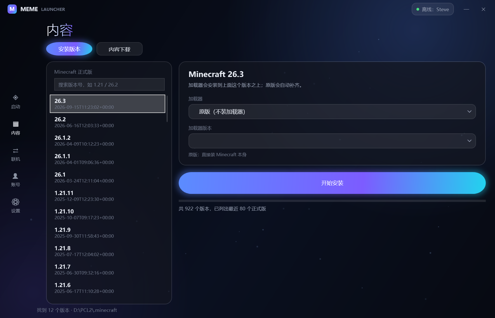</td></tr></table>

| 内容 | 账号 |
|---|---|
<table><tr><td>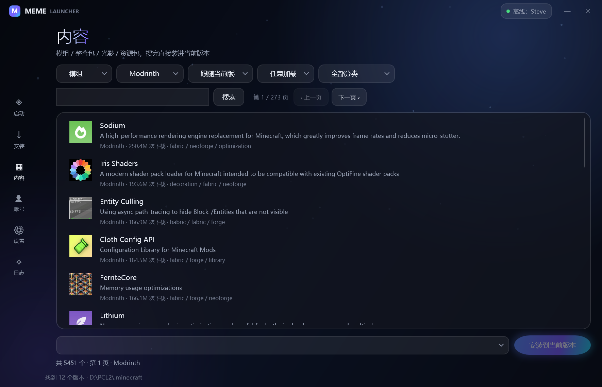</td><td>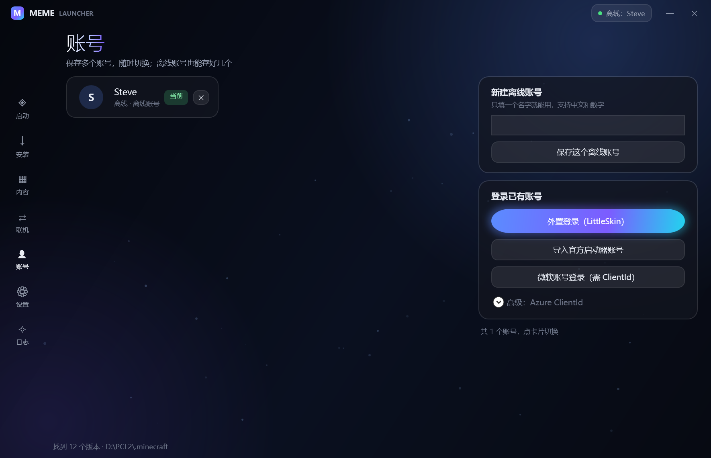</td></tr></table>

| 设置 | 联机 |
|---|---|
<table><tr><td>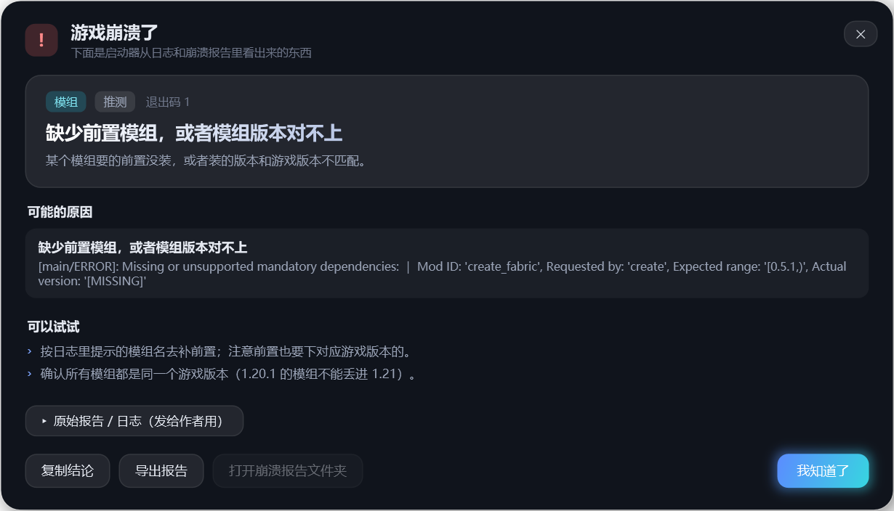</td><td>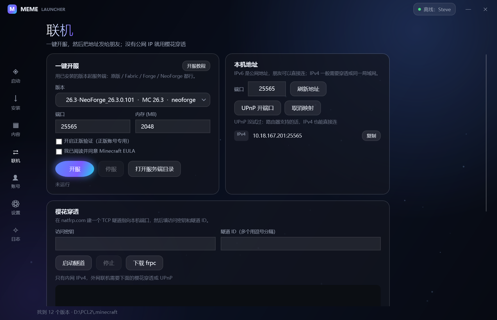</td></tr></table>

---

## 微软登录的现状

链路本身是通的，已经实测到第 4 步：

| 步骤 | 结果 |
|---|---|
| 设备码 → 微软 token | ✅ |
| Xbox Live | ✅ |
| XSTS | ✅ |
| `login_with_xbox` | ❌ 403 `Invalid app registration` |

Minecraft 服务端有应用白名单，新注册的 Azure 应用默认不在里面。已经按官方流程提交 AppID Review 申请，等待 Mojang Enforcement 审批。**通过后不需要改任何代码**，Client ID 已内置。

完整记录见 [docs/MSA-LOGIN.md](docs/MSA-LOGIN.md)。

---

## 已知限制

- NeoForge 服务端安装器仍会尝试直连 `maven.neoforged.net`；依赖已预下载到本地，正常网络下可用，极端网络环境可能超时
- 微软登录等待白名单（见上）
- UPnP 依赖路由器支持；校园网 / 公司网通常不可用
- 内网穿透需要自备 [SakuraFrp](https://www.natfrp.com/) 账号（免费）

---

## 从源码构建

```powershell
# 需要 .NET 6 SDK
dotnet build  src/Aurora.App/Aurora.App.csproj -c Release
dotnet publish src/Aurora.App/Aurora.App.csproj -c Release -r win-x64 --self-contained true `
  -p:PublishSingleFile=true -p:IncludeNativeLibrariesForSelfExtract=true `
  -p:EnableCompressionInSingleFile=true -o dist
```

或者直接跑 `build.ps1` / `启动 Aurora.cmd`。

### 目录结构

```
src/
├─ Aurora.Core/          # 引擎（无 UI 依赖）
│  ├─ Accounts/          # 账号模型与持久化
│  ├─ Auth/              # 微软设备码 / 外置登录 / 官方启动器导入
│  ├─ Configuration/     # 设置读写
│  ├─ Java/              # Java 探测与版本匹配
│  ├─ Launch/            # 启动计划、命令行、崩溃分析
│  ├─ Models/            # version.json 模型
│  ├─ Net/               # 下载器、安装器、内容源、更新检查、自更新
│  ├─ Network/           # 本机地址探测 / UPnP / 樱花 frpc
│  ├─ Server/            # 服务端准备（原版 / Fabric / Forge / NeoForge）
│  ├─ Skins/             # 离线皮肤（CustomSkinLoader）
│  └─ Versions/          # 版本仓库、继承合并、rules
├─ Aurora.Cli/           # 无界面命令行
└─ Aurora.App/           # WPF 界面
docs/
├─ ARCHITECTURE.md
├─ MSA-LOGIN.md
└─ screens/              # 界面截图
```

---

## 致谢

- 下载镜像：[BMCLAPI](https://bmclapi2.bangbang93.com/)
- 内容源：[Modrinth](https://modrinth.com/)、[CurseForge](https://www.curseforge.com/)
- 外置登录：[authlib-injector](https://github.com/yushijinhun/authlib-injector)、[LittleSkin](https://littleskin.cn/)
- 皮肤：[CustomSkinLoader](https://github.com/xfl03/MCCustomSkinLoader)
- 内网穿透：[SakuraFrp](https://www.natfrp.com/)

Minecraft 是 Mojang Studios 的商标，本项目与 Mojang / Microsoft 无隶属关系。

---

## 开源协议与隐私

- 许可证：[MIT](LICENSE)
- 隐私说明：[docs/PRIVACY.md](docs/PRIVACY.md)（本地运行，不收集任何使用数据）
- 代码签名：由 [SignPath Foundation](https://signpath.org/) 免费提供
---

## 法律声明

本项目是第三方启动器，**与 Mojang / Microsoft 无关**，未获其批准或授权。
不提供、不分发、不破解游戏本体；请通过官方渠道购买 Minecraft。
完整的免责条款、许可范围、账号与数据处理说明见 [LEGAL.md](LEGAL.md)。
启动器内也可以从「设置 → 其他 → 免责声明 / 许可」打开。